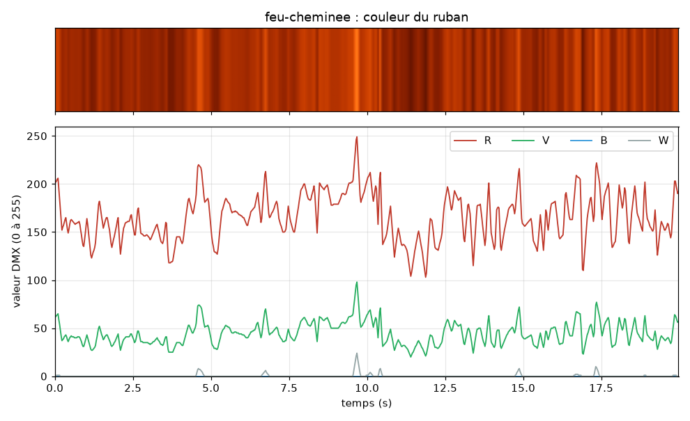
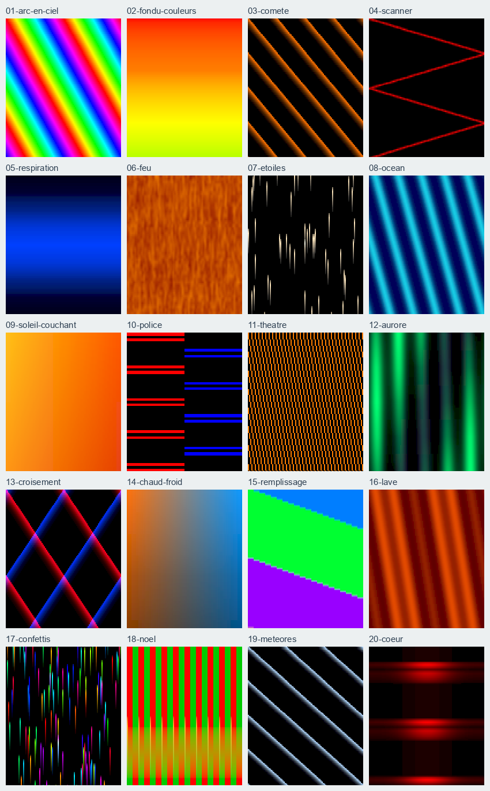

# Conduites stockées

Un nœud peut garder en mémoire une **conduite** : une suite de couleurs et de valeurs
DMX qu'il joue en boucle, seul, dès qu'on le met sous tension. Pas besoin du Pi ni de
QLC+ pour qu'elle tourne. Exemple fourni : un feu de cheminée sur un ruban RGBW.

Détails techniques : [SPEC §4.13](../spec/SPEC.md), [PROTOCOL §10](../spec/PROTOCOL.md),
[ADR 0016](../spec/adr/0016-conduites-stockees.md).

## 1. Ce que fait le nœud

| Situation | Ce qui pilote les sorties |
|-----------|---------------------------|
| Mise sous tension, pas de DMX | La conduite, depuis le début |
| QLC+ envoie l'univers du nœud | QLC+, dès la première trame |
| QLC+ se tait depuis `resume_s` secondes (5 s par défaut) | La conduite, depuis le début. Compter 12 à 15 s en tout : le dongle répète encore le dernier univers pendant `hold_timeout` (10 s) |
| `dmxnow identify` | Le clignotement d'identification, puis retour à la situation d'avant |

La conduite pilote les **4 sorties rubans** et, si elle les contient, des **canaux de la
ligne DMX** (un projecteur branché sur la XLR). Les canaux qu'elle ne contient pas restent
à 0.

🔴 **Le relais ne suit jamais la conduite.** Il garde son état de mise sous tension. Si
l'alimentation des rubans est branchée sur une sortie 230 V du nœud (J4 ou J7), régler le
relais allumé au démarrage, sinon la conduite tourne sur un ruban sans courant :

```
dmxnow set node-2442B0 relay_power_on=1
```

Un ruban branché sur les sorties J6 et J8 n'est pas adressable : toute sa longueur a la
même couleur à un instant donné. Le feu se fait dans le temps (scintillement, flambées,
creux), pas le long du ruban. Un ruban adressable passe par un décodeur sur la ligne DMX
et se pilote pixel par pixel (§2 bis).

## 2. Générer une conduite

Une conduite est un fichier `.dxs`, calculé à l'avance par un script Python. Les scripts
sont dans `shows/` ; ils n'ont besoin que de la bibliothèque `pi/dmxnow`.

```
PYTHONPATH=pi python3 shows/feu_de_cheminee.py
```

```
feu-cheminee: 4 channel(s) [+1, +2, +3, +4], 2995 keyframes, loop 300.3 s, resume after 5 s without DMX, 18010 bytes
written shows/feu-de-cheminee.dxs
```

Options utiles :

| Option | Effet |
|--------|-------|
| `--brightness 60` | Feu moins lumineux (60 %) |
| `--minutes 10` | Boucle de 10 minutes au lieu de 5 |
| `--fixture-rgb 20` | Pilote aussi un projecteur RGB sur la XLR, canaux 20, 21, 22 |
| `--fixture-dimmer 19` | Pilote aussi le gradateur d'un projecteur (canal 19) |
| `--relay-dmx 0` | Pour un nœud réglé `relay_dmx=0` (rubans dès `start_address`) |
| `--resume-s 30` | La conduite reprend 30 s après la fin du DMX |

Les canaux des rubans sont comptés **depuis l'adresse du nœud** (`+1` à `+4` avec le
relais sur `start_address`) : un même fichier sert à tous les nœuds rubans, quelle que
soit leur adresse. Les canaux d'un projecteur sont **absolus** (1 à 512).

Voir le résultat avant de le déployer :

```
PYTHONPATH=pi python3 -m dmxnow.cli show inspect shows/feu-de-cheminee.dxs
PYTHONPATH=pi enclosure/.venv/bin/python shows/preview.py shows/feu-de-cheminee.dxs -o feu.png
```



Une autre conduite (respiration, lever de soleil, orage, etc.) s'écrit de la même façon :
un script qui crée un `Show`, ajoute des images clés (`step(durée_ms, valeurs)`) et
écrit `encode()` dans un fichier. Le nœud fait un fondu linéaire d'une image à la
suivante, puis revient à la première. Claude Code peut écrire ces scripts à la demande.

## 2 bis. Ruban adressable : 20 conduites prêtes

Pour le ruban WS2811 24 V de 10 m (100 pixels, ordre R, B, G) branché derrière un
SP201E réglé sur l'adresse 41 ([cablage.md §4 bis](cablage.md)). Chaque conduite pilote
les canaux absolus 41 à 340 de la ligne DMX, soit 3 canaux par pixel.

```
PYTHONPATH=pi python3 shows/ruban_pixels.py                      # les 20, dans shows/pixels/
PYTHONPATH=pi python3 shows/ruban_pixels.py --brightness 50      # moitié moins lumineux
PYTHONPATH=pi python3 shows/ruban_pixels.py --addr 1 --pixels 60 --order RGB   # autre ruban
```



| Fichier | Effet |
|---------|-------|
| `01-arc-en-ciel` | Deux arcs-en-ciel qui défilent (3 s par tour) |
| `02-fondu-couleurs` | Tout le ruban passe lentement d'une couleur à l'autre (18 s) |
| `03-comete` | Comètes orange qui filent, une tous les 25 pixels |
| `04-scanner` | Un point rouge qui fait l'aller-retour (2 s) |
| `05-respiration` | Bleu qui s'allume et s'éteint doucement (4 s) |
| `06-feu` | Braises qui scintillent tout le long du ruban |
| `07-etoiles` | Étoiles blanches qui s'allument au hasard sur un ciel bleu nuit |
| `08-ocean` | Vagues bleues et turquoise qui avancent |
| `09-soleil-couchant` | Dégradé jaune, orange, rouge, violet, nuit, puis retour (48 s) |
| `10-police` | Moitié gauche rouge, moitié droite bleue, en double éclat |
| `11-theatre` | Chenillard ambre, un pixel sur trois |
| `12-aurore` | Voiles verts et violets qui ondulent lentement (30 s) |
| `13-croisement` | Comète rouge et comète bleue qui se croisent |
| `14-chaud-froid` | Dégradé ambre vers bleu qui respire (10 s) |
| `15-remplissage` | Le ruban se remplit d'une couleur, puis de la suivante |
| `16-lave` | Coulée rouge et orange qui avance lentement |
| `17-confettis` | Points de couleur au hasard qui s'éteignent en fondu |
| `18-noel` | Rouge et vert qui s'échangent, avec un éclat doré |
| `19-meteores` | Traînées blanc bleuté qui filent |
| `20-coeur` | Battement de cœur rouge, plus fort au milieu du ruban |

- Le nœud doit avoir un firmware du 2026-10-16 ou plus récent (512 canaux). Un firmware
  plus ancien refuse le fichier au `show deploy` (`INVALID_ARG`), sans rien casser.
- La ligne DMX doit sortir au moins 340 canaux : `dmxnow set node-2442B0 dmx_out_slots=340`.
- 🔴 L'alimentation du ruban et du SP201E est sur J7 : pour que la conduite s'allume seule
  à la mise sous tension, `dmxnow set node-2442B0 relay_power_on=1`.
- Taille : 1 à 36 ko, soit 6 à 190 morceaux de 192 octets au déploiement.
- Vu au banc le 2026-10-16 : les 20 conduites déployées une à une sur node-2442B0 et
  jouées seules par le nœud, toutes conformes à leur description sur les 100 pixels.
- Aperçu de la planche : `PYTHONPATH=pi enclosure/.venv/bin/python shows/preview_pixels.py
  shows/pixels/*.dxs -o docs/figures/conduites-pixels.png`.

## 3. Déployer

Depuis le Pi, démon lancé, nœud enrôlé et entendu (`dmxnow nodes`) :

```
dmxnow show deploy shows/feu-de-cheminee.dxs node-2442B0
dmxnow show deploy shows/feu-de-cheminee.dxs all        # tous les nœuds enrôlés entendus
```

Le fichier part en morceaux de 192 octets, nœud par nœud, puis le nœud vérifie sa taille
et son CRC avant de le jouer. Un fichier abîmé est refusé avant tout envoi. Si QLC+
envoie déjà l'univers du nœud, la conduite attend que le DMX s'arrête.

| Commande | Effet |
|----------|-------|
| `dmxnow show info node-2442B0` | Nom de la conduite, en cours ou en attente, durée de la boucle |
| `dmxnow show clear node-2442B0` | Efface la conduite (le nœud revient au comportement sans conduite) |
| `dmxnow nodes` | La marque `SHOW` signale les nœuds dont la conduite tourne |

Un `factory-reset` (ou un appui de 10 s sur SW1) efface aussi la conduite.

## 4. Points à vérifier au banc

Vus sur node-2442B0 ([SPEC V-FW-09](../spec/SPEC.md)) :

- [x] la conduite démarre seule à la mise sous tension, lue depuis la flash (2026-10-15) ;
  avec `relay_power_on=1`, le nœud ferme aussi son relais et le feu tourne sur le ruban
  alimenté par J7, sans Pi ni démon (coupure secteur de 5 s, 2026-10-16) ;
- [x] le DMX reprend la main à sa première trame ; la conduite revient 12 à 15 s après
  son arrêt (2026-10-15) ;
- [x] le déploiement passe sans erreur, jusqu'à 36 ko, sans redémarrage du nœud
  (2026-10-16, après la correction du CRC de `SHOW_COMMIT`) ;
- [x] rendu du feu sur le ruban RGBW (2026-10-15) et des 20 conduites sur le ruban
  WS2811 (2026-10-16) ;
- [ ] `dmxnow show clear` puis redémarrage : plus de conduite (pas encore essayé).
